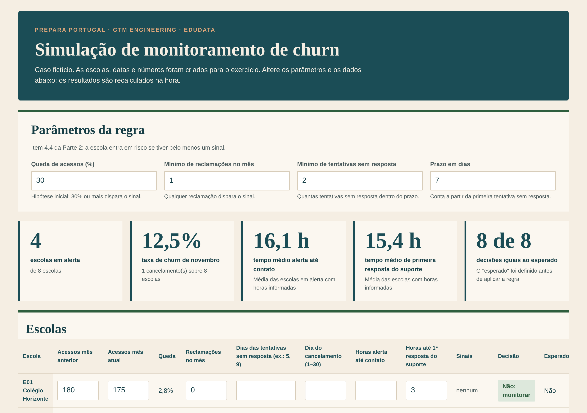

# GTM Engineering aplicado ao churn: um caso fictício em Análise de Dados

> **Caso fictício.** A empresa EduData, as escolas, as datas e os números deste projeto foram criados para um exercício do curso Análise de Dados e TI aplicada à Gestão (Prepara Portugal). Não são dados reais.

**Autora:** Daniela Ramos. Bacharel em Direito (OAB/Brasil), com experiência em gestão de processos e coordenação de equipes; estudante de dados e IA.

**Apresentação online:** https://danielaramosadv.github.io/portfolio-gtm-engineering/  
**Dashboard:** https://danielaramosadv.github.io/portfolio-gtm-engineering/dashboard/  
**LinkedIn:** https://www.linkedin.com/in/danielaramosadv

## O problema

A EduData vende plataformas para escolas privadas. O cenário traz quatro problemas:

- taxa de conversão de leads baixa (4%);
- CRM desatualizado, com registros duplicados;
- pesquisa manual sobre os leads;
- demora para identificar sinais de churn (cancelamento).

Escolhi o último problema. A pergunta de trabalho é: o tempo de resposta do suporte contribui para o risco de cancelamento? O cenário não responde isso, então o fluxo mede a relação em vez de afirmá-la.

Na Parte 1, a primeira ação que eu recomendo é limpar o CRM, porque sem cadastro único nenhum alerta é confiável. Escolhi o churn porque o exercício pedia uma das ações, e o fluxo de churn já nasce com código único por escola. Assim, consigo mostrar o fluxo completo num recorte pequeno. Com o CRM limpo, o próximo passo seria aplicar o mesmo fluxo à base inteira.

## A solução

Um fluxo de monitoramento com ferramentas gratuitas (Google Forms e Google Sheets), em quatro etapas:

1. **Entrada:** reclamações, pedidos de suporte e contatos registrados no Google Forms; acessos vindos de uma exportação da plataforma.
2. **Organização:** uma linha por escola, identificada por um código único.
3. **Decisão:** a regra verifica três sinais. Basta um para gerar alerta:
   - queda de 30% ou mais nos acessos de 1 a 15 do mês em relação ao mesmo período do mês anterior (dia de corte: 15);
   - pelo menos uma reclamação no mês;
   - duas tentativas de contato sem resposta em até 7 dias.
4. **Ação humana:** o Customer Success entra em contato com a escola e registra a data e a hora.

## O que a simulação mostrou

A simulação usa oito escolas fictícias, cada uma criada para testar um caso da regra. Defini o resultado esperado de cada uma antes de aplicar a regra.

- **8 de 8** decisões iguais ao esperado, inclusive nos casos de fronteira (queda de 29%, segunda tentativa 8 dias depois).
- **10,1 horas** em média entre o alerta e o primeiro contato (4 alertas).
- **15,4 horas** em média até a primeira resposta do suporte (5 pedidos).
- **12,5%** de churn no mês (1 cancelamento em 8 escolas).

## O que a simulação não prova

- Os dados são fictícios. Testam a regra, não o comportamento real das escolas.
- Com oito escolas, uma escola altera a taxa em 12,5 pontos. Os números servem para comparar tendências, não para concluir.
- Não há período anterior ao fluxo para comparar. Não é possível dizer se 10,1 horas é um bom tempo.
- A relação entre atendimento e churn é uma hipótese, que a simulação não testa.

O próximo passo seria um piloto com 6 a 8 escolas reais durante dois meses, com a equipe de Customer Success. Ele não foi executado.

## Conteúdo do repositório

| Arquivo | O que é |
|---|---|
| [`index.html`](index.html) | Apresentação, do conceito aos resultados. Versão online: [link do GitHub Pages](https://danielaramosadv.github.io/portfolio-gtm-engineering/). |
| [`dashboard/index.html`](dashboard/index.html) | Planilha interativa da simulação: os parâmetros e os dados podem ser alterados, e os resultados são recalculados. |
| [`planilha/`](planilha/) | Dados da simulação e as fórmulas da planilha, em texto. |

## Documentos de origem

- Estudo de caso completo, com as partes 1 a 4 do exercício: [Notion](https://quasar-acoustic-ae7.notion.site/Exerc-cio-GTM-Engineering-Parte-1-Diagn-stico-41690545a6f48162ac8df34102beaee8)
- Fluxograma do processo: [Miro](https://miro.com/app/board/uXjVEOE7UM4=/?share_link_id=102873765003)
- Planilha da simulação no Google Sheets: [Planilha](https://docs.google.com/spreadsheets/d/1uRf08qulpb-NUJR8dnVT0MUVtd1jTdcAbuN4e0R8P90/edit?usp=sharing)

## Uso de IA

Usei o Claude como apoio na estrutura, na revisão do texto e na construção das páginas interativas. As escolhas de conteúdo, a regra, o caso e as conclusões são minhas, e consigo explicá-las e defendê-las. Esta nota segue a mesma transparência do estudo de caso no Notion.

## Melhorias que eu faria

Com base no feedback do professor, estes são os pontos que mudaria numa segunda versão:

- **Comparar o mesmo número de dias.** Já fiz esta mudança: os acessos são comparados de 1 a 15 de outubro com 1 a 15 de novembro, com corte no dia 15. Assim o mês incompleto não entra na conta. Uma versão mais completa usaria os últimos 30 dias, mas exige acessos diários, que a simulação não tem.
- **Usar uma janela móvel nos contatos.** Hoje a janela parte da primeira tentativa sem resposta. Uma janela recalculada a cada novo registro mostra melhor a insistência recente.
- **Registrar o resultado de cada contato.** Hoje registro só a data e a hora do primeiro contato. Registrar se a escola respondeu, agendou ou cancelou permitiria medir o efeito do contato, não só o tempo.

## Aprendizados

- Definir o resultado esperado antes de rodar o teste evita ajustar a conclusão ao resultado.
- Automatizar sobre dados duplicados gera alertas errados. A base precisa vir antes.
- Um número sem linha de base não diz se é bom ou ruim.
- Dados fictícios servem para validar a lógica. Para medir efeito, é preciso dado real ao longo do tempo.
